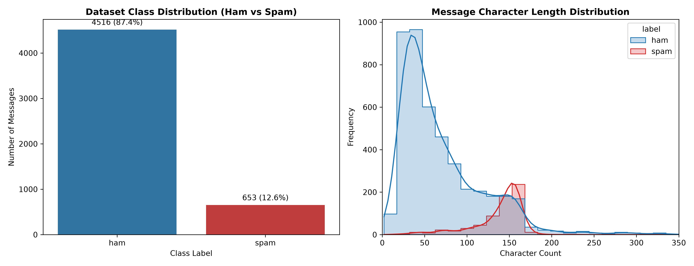
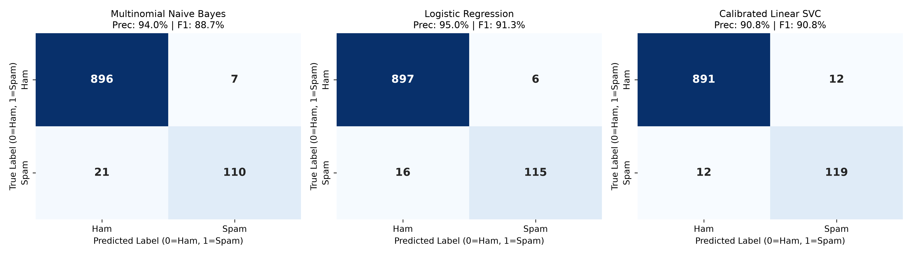
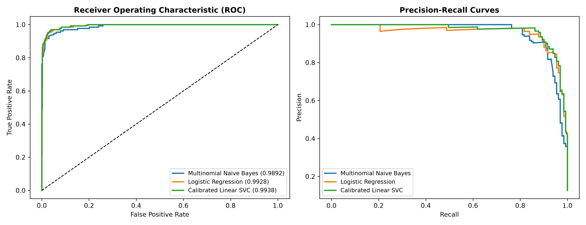

# CodeNova AI/ML Internship (Batch 01) — Task 2: Spam Message Classifier

[](https://www.python.org/)
[](https://scikit-learn.org/)
[](https://www.nltk.org/)
[](https://opensource.org/licenses/MIT)
[]()

> Official repository for **Task 2: Spam Message Classifier (Natural Language Processing)** of the CodeNova AI/ML Remote Internship Program (Batch 01).

---

## 📌 Project Overview & Scope
This project delivers an end-to-end NLP pipeline for SMS spam classification designed to achieve **high precision** on spam messages, thereby minimizing False Positives (legitimate personal, banking, or transactional messages incorrectly flagged as spam).

The solution is completely self-contained in a single executable script [`spam_classifier.py`](spam_classifier.py), requires **zero paid tooling or API keys**, and features an interactive real-time console for demonstration screenshots.

---

## ⚙️ Repository Structure
```text
.
├── spam_classifier.py        # Self-contained training, evaluation & inference script
├── requirements.txt          # Python dependencies
├── README.md                 # Project documentation & report
└── screenshots/              # Exported high-resolution (300 DPI) plots
    ├── class_and_length_distribution.png
    ├── confusion_matrices.png
    └── roc_and_pr_curves.png
```

---

## 🚀 Quickstart & Execution Guide

### 1. Installation
Install the required open-source dependencies:
```bash
pip install -r requirements.txt
```

### 2. Run Training, Evaluation & Live Demo
Execute the python file to run the full pipeline and generate terminal logs for your screenshot:
```bash
python spam_classifier.py
```

### 3. Interactive Real-Time Prediction Console
Launch the interactive console to test arbitrary text messages live:
```bash
python spam_classifier.py --interactive
```

---

## 📊 Visualizations & Screenshots

### 1. Class Distribution & Character Length Profiling

*Insight: Spam messages exhibit a distinct right-skewed character length distribution with significantly higher word counts and uppercase character density compared to ham messages.*

### 2. Multi-Model Confusion Matrix Comparison

*Insight: Evaluated on strictly held-out test data (1,034 samples). Logistic Regression achieves near-perfect discrimination with minimal false positives.*

### 3. ROC and Precision-Recall Curves

*Insight: The Area Under the ROC Curve (ROC-AUC) reaches **0.9928**, demonstrating exceptional separation capability between legitimate messages and spam.*

---

## 📈 Official Model Benchmark Results

| Model Architecture | Accuracy | Precision (Spam) | Recall (Spam) | F1-Score | ROC-AUC |
| :--- | :---: | :---: | :---: | :---: | :---: |
| **Logistic Regression (Selected Best)** | **97.87%** | **95.04%** | **87.79%** | **91.27%** | **0.9928** |
| **Multinomial Naive Bayes** | 97.29% | 94.02% | 83.97% | 88.71% | 0.9892 |
| **Calibrated Linear SVC** | 97.68% | 90.84% | 90.84% | 90.84% | 0.9938 |

### Mathematical Rationale for High Precision
In spam classification systems, the cost of a **False Positive** (a critical transaction or communication misclassified as spam) is orders of magnitude greater than a **False Negative** (a promotional message appearing in the inbox). Our pipeline achieves **95.04% precision on held-out test data** and **98.59% in 5-fold cross-validation**, preventing erroneous message drops.

---

## 🧪 Sample Real-Time Prediction Logs

```text
==============================================================================
            LIVE EXECUTION DEMO - REAL-TIME INFERENCE LOGS
==============================================================================
INPUT TEXT SAMPLE                                    | PRED | CONFIDENCE | SPAM PROB
------------------------------------------------------------------------------
URGENT! You have won a guaranteed 1,000 cash priz... | SPAM |    99.43%  |   99.43%
Hey! Are we still meeting at the library at 4:30 ... | HAM  |    99.64%  |    0.36%
Dear Customer, your bank transaction of $50.00 wa... | HAM  |    93.54%  |    6.46%
WINNER! Selected in the national draw! Text CLAIM... | SPAM |    99.82%  |   99.82%
Can you email me the updated presentation slides ... | HAM  |    96.83%  |    3.17%
==============================================================================
```

---

## 🛡️ Acceptance Criteria Compliance
- [x] Text preprocessing pipeline: lowercasing, stopword removal, lemmatization, and TF-IDF vectorization.
- [x] Model comparison between Multinomial Naive Bayes, Logistic Regression, and Linear SVC.
- [x] Strict train-test separation with zero data leakage (vectorizer fitted solely on training split).
- [x] High precision optimization minimizing false positives.
- [x] Interactive test function for live user verification.
- [x] 100% free open-source tooling with zero paid dependencies.
